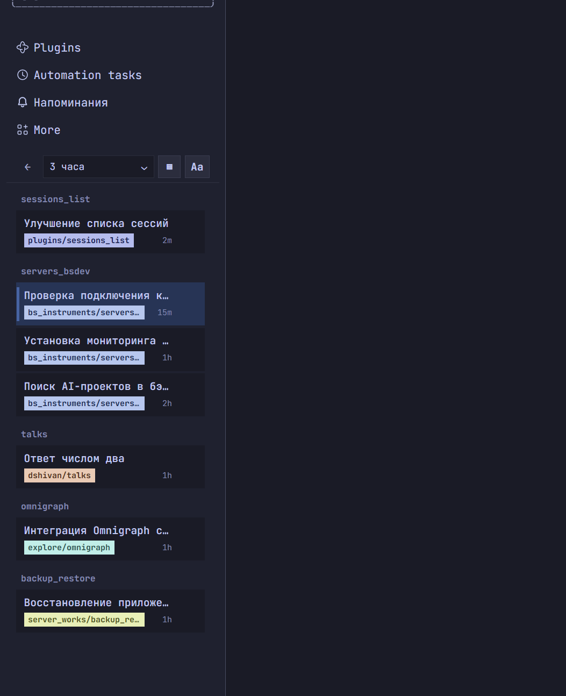

# dsh-bs-focus

[Русский](#русский) · [English](#english)

## Русский

**Фокус сессий** — отдельный компактный режим списка сессий для DeepSeek Harness. Плагин не изменяет штатные режимы списка и позволяет в любой момент вернуться к ним.



### Возможности

- фильтрация сессий по активности: 3 часа, 6 часов, 1 день, 3 дня или все;
- сортировка сессий от самых свежих к старым;
- необязательная группировка по Workspace с сортировкой проектов по их самой свежей сессии;
- цветные метки проектов по двум последним папкам пути;
- компактные значения времени: `<1m`, `5m`, `2h`, `3d`;
- состояния сессии с приглушённой цветной подсветкой всей карточки;
- отдельная строка **НЕ ПРОЧИТАНО** для завершённого ответа, который ещё не был открыт;
- штатное контекстное меню сессии;
- сохранение режима, периода и настроек отображения в браузере.

### Состояния

- синий — сессия работает;
- оранжевый — ждёт ответа пользователя;
- жёлтый — ждёт подтверждения;
- бирюзовый — ждёт проверки плана;
- зелёный — непросмотренное завершение;
- без подсветки — обычная неактивная сессия.

### Использование

После установки нажмите **Фокус** внизу боковой панели. Кнопка со стрелкой в верхней строке возвращает штатный список. Кнопка периода открывает меню фильтра активности, `▦` включает группировку по проектам, а `Aa` показывает цветные метки проектов.

### Установка

```bash
dsh plugin --profile web add dsh-bs-focus@latest
```

Или установите пакет через **Plugins → Add plugin** в интерфейсе DeepSeek Harness.

### Совместимость

Требуется DeepSeek Harness `>=0.2.2-rc.2`. Плагин предназначен для Web GUI и использует публичные Client Slots и статусы сессий DSH.

### Ограничения

- вход в режим «Фокус» находится внизу боковой панели, потому что DSH не предоставляет отдельный публичный слот внутри заголовка штатного списка;
- штатная отметка непрочитанного сбрасывается при открытии сессии и не сохраняется после полной перезагрузки клиентской страницы;
- настройки режима хранятся локально в текущем браузере.

## English

**Session focus** adds a separate compact, activity-oriented session browser to DeepSeek Harness without modifying the built-in list modes.


### Features

- activity filters for 3 hours, 6 hours, 1 day, 3 days, or all sessions;
- newest-first ordering for sessions;
- optional Workspace grouping, with projects ordered by their newest session;
- stable colored project labels based on the final two path folders;
- compact activity times such as `<1m`, `5m`, `2h`, and `3d`;
- muted full-card colors for running and waiting states;
- a dedicated **UNREAD** line for a completed response that has not been opened;
- the standard DSH session context menu;
- browser-local persistence for the mode and display preferences.

### Usage

Choose **Focus** in the sidebar footer. The arrow returns to the built-in browser. The period button opens the activity filter menu, `▦` toggles project grouping, and `Aa` toggles project labels.

### Installation

```bash
dsh plugin --profile web add dsh-bs-focus@latest
```

Requires DeepSeek Harness `>=0.2.2-rc.2`.

## License

MIT © Ivan Sannikov
